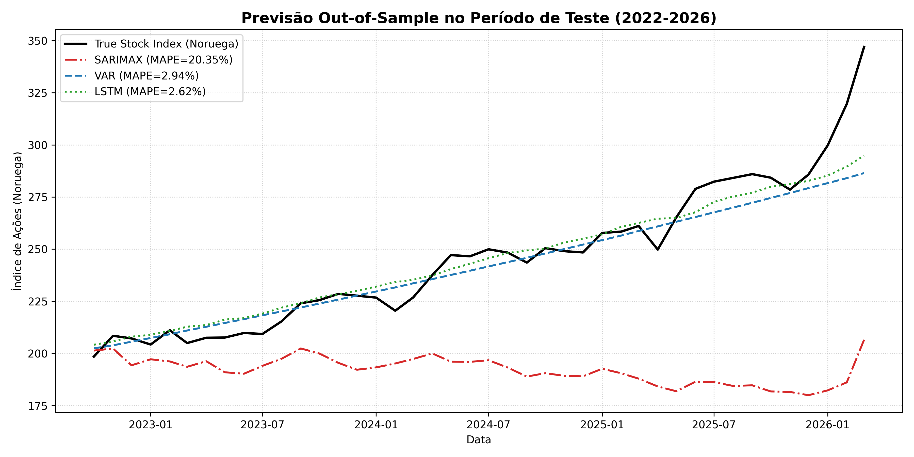

# Forecasting the Norwegian Stock Index: SARIMAX vs VAR vs LSTM

Monthly forecasting of Norway's share price index using its macro-financial links to Brent crude oil and the USD/NOK exchange rate (1992 to 2026). Norway is a major oil exporter, so the question is how much oil and the currency help predict the stock market, and whether a neural network beats classical econometric models.

Team project for the *Time Series Analysis and Forecasting* course, MSc in Data Science, ISCTE (2025/26), developed with Afonso Claudino.

## Method

- **Data:** three monthly series from FRED (share index, USD/NOK, Brent oil), 411 observations, downloaded with `src/download_data.py`.
- **Exploration and stationarity:** log transform, ADF/KPSS unit root tests, first differences. A Johansen test (see `report/main.tex`) found no cointegration, so the VAR is estimated in differences.
- **Models:**
  - SARIMAX on the log index with Brent oil as an exogenous variable (order chosen by `pmdarima` auto-ARIMA)
  - VAR(2) on the three differenced log series
  - LSTM in PyTorch on the same multivariate input
- **Evaluation:** 90/10 train/test split, out-of-sample RMSE, MAE and MAPE, plus a forward forecast.

## Results (out-of-sample)

| Model | RMSE | MAE | MAPE |
|---|---|---|---|
| SARIMAX | 65.51 | 53.90 | 20.35% |
| VAR(2) | 13.00 | 7.89 | 2.94% |
| LSTM | **11.29** | **6.87** | **2.62%** |

The multivariate models clearly beat the univariate one. The LSTM was the most accurate, with the VAR close behind and much easier to interpret.



## Repository structure

```
data/norway_data.csv            # merged monthly dataset
src/download_data.py            # downloads the series from FRED
src/eda_and_stationarity.py     # EDA, unit root and cointegration tests
src/models_and_evaluation.py    # SARIMAX, VAR, LSTM, evaluation and forecast
analysis.ipynb                  # notebook version with outputs
report/report.pdf               # full written report (Portuguese)
report/                         # LaTeX source, plots and result tables
```

## How to run

```bash
pip install pandas numpy matplotlib statsmodels pmdarima scikit-learn torch
python src/download_data.py          # optional, data is already included
python src/eda_and_stationarity.py
python src/models_and_evaluation.py
```

Run the scripts from the repository root.

## Tech stack

Python · pandas · statsmodels · pmdarima · PyTorch · scikit-learn · matplotlib · LaTeX

## Team

André Marques and Afonso Claudino. The full report with the team's methodology and discussion is in [`report/report.pdf`](report/report.pdf) (Portuguese).
